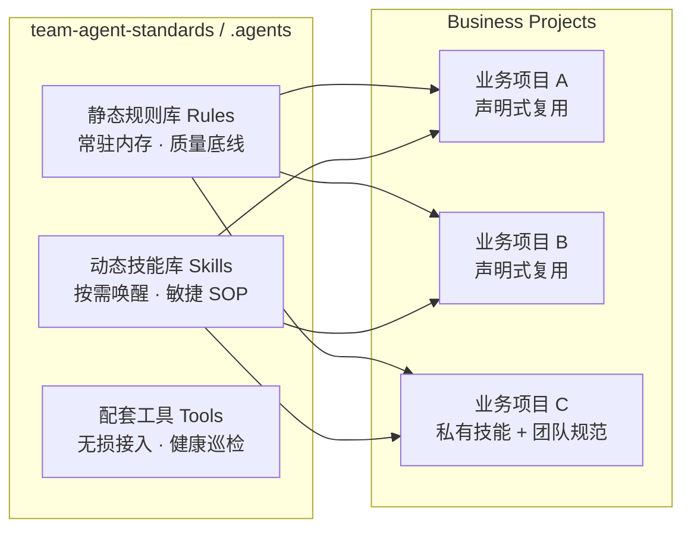

# team-agent-standards

> **团队统一的 AI Agent 研发规范与工程技能套件**  
> 为团队提供开箱即用、纪律严密的代码质量红线、高级敏捷工程 SOP 技能库，以及配套的一键接入工具。

[]()
[]()
[]()
[]()


---

## 🎯 项目愿景与解决的问题

### 💡 认知跃迁：从“AI 辅助编码”走向“Agent 辅助研发”

在探讨研发规范前，首先需要明确人机协同正在经历的根本性代际跃迁：

| 维度 | AI 辅助编码 (1.0 时代 / Copilot & Chat) | Agent 辅助研发 (2.0 时代 / Autonomous Agents) |
| :--- | :--- | :--- |
| **典型形态** | 代码行内自动补全、单轮问答对话框 | Google Antigravity、Claude Code、Cursor Composer / Agent、CodeX |
| **工作方式** | **被动生成、无系统权限**：人写一半，AI 猜下一句；或人工贴代码，AI 解释代码 | **目标驱动、环境感知、自主闭环**：开发者下达目标，智能体自主规划、读写项目多文件并执行终端命令自测 |
| **核心能力** | 纯 LLM 文本补全与概率预测 | **ReAct 范式 + Tool Use（工具调用）**：自主编辑代码库、调用 Shell 编译运行测试、操作 Git 协同 |
| **失控风险** | 仅限于“生成的代码段不好用”，人工审查易发现 | **具备真实破坏力**：直接改乱代码资产、借格式化污染 `git blame`、假自测幻觉、擅自提交 Git |

> **为什么 Agent 时代更需要严格的工程规范？**  
> 在 1.0 时代，AI 只是“被动的打字机”；而在 2.0 时代，Agent 已经成为了具备真实系统操作权限的“初级工程师”。**Agent 拥有的自主权限越大，缺乏纪律时的破坏力就越大。**

在缺少团队工程约定时，工程师往往陷入 **“个人提示词零散、Agent 交付质量不可控、风格五花八门、盲目堆叠代码导致隐式 Bug 频发”** 的困境：

- **Agent 行为无纪律**：Agent 容易偷懒生成 `// TODO: implement later`、写空函数、静默吞掉异常，甚至在未实际运行命令的情况下空口宣称“测试全部通过”；
- **缺乏系统化工程 SOP**：传统单轮对话缺少“需求深挖 $\to$ 架构决策 $\to$ 规格说明 $\to$ 任务切片 $\to$ TDD $\to$ 双轴审查”的完整流程，直接让 Agent 盲目堆写代码容易导致上下文爆炸与架构幻觉；
- **团队规范孤岛化**：各业务项目各自为战，规范难以在全团队范围内统一定义、平滑分发与持续演进。

**`team-agent-standards`** 将团队级高质量敏捷工程实践抽象为标准化的 Agent 资产，让团队中的每一位工程师本地的 **编码 Agent** 都能具备统一的工程纪律与专业能力：



- **静态规则（Rules）**：4 大质量宪法常驻 Agent 系统上下文，严格约束行为底线；
- **动态流程（Skills）**：经受业界实战检验的 13 大核心工程技能（SOP），覆盖研发全生命周期与底层质询/建模；
- **跨项目复用（Cross-Project Reuse）**：业务项目两行配置无损接入，Vendor 模式离线可用，团队更新一人拉取、全组即时生效。


---

## ⚡ 30 秒极速上手

### 步骤 1：本地首次安装（每台电脑仅需执行一次）

在本地统一的代码工作区根目录（即存放各个业务项目的父级目录，如 `~/codes` 或 `D:/codes`）打开 **Git Bash**：

```bash
cd codes
git clone <团队远程Git仓库地址>/team-agent-standards.git .agents
```

> [!NOTE]
> 仓库在本地克隆的文件夹名称必须命名为 **`.agents`**。所有技能源码均已内联锁定（Vendor 模式），**无需安装任何外部 npm 依赖，开箱即用，离线可用**。

---

### 步骤 2：为业务项目一键开启规范

进入你需要接入规范的具体业务项目根目录，在 Git Bash 中运行一行初始化脚本：

```bash
cd codes/my-project
../.agents/scripts/init-project.sh
```

#### 🛡️ 智能兼容与无损合并特性 (Non-Destructive Integration)
接入脚本内置完善的防御性设计，能够平滑兼容全新项目与已有历史业务项目：
- **无损合并 `skills.json`**：若业务项目已有本地私有技能配置（如已有 `"entries": [...]`），脚本通过 JSON 引擎安全合并通用技能路径，**100% 完整保留业务项目原有的私有技能与自定义配置**；
- **智能增量注入已有规则文件**：自动识别根目录下的 `AGENTS.md`、`GEMINI.md` 等规则文件；若已有规则文件，仅在原有一级标题正下方增量注入缺失的通用规范引用，**保留项目原标题与原有全部业务规则，绝不产生重复标题与破坏性覆盖**；
- **安全幂等**：多次重复执行自动检测并跳过，零副作用。

接入完成后，业务项目的接入配置仅需提交两个精炼文件：

```json
// .agents/skills.json（纯净简洁，零网络外部依赖）
{
  "entries": [
    {
      "path": "../.agents/skills"
    }
  ]
}
```

```markdown
<!-- AGENTS.md 或现有规则文件 -->
# Project Guidelines

@[Agent行为准则](../.agents/rules/agent.md)
@[通用编码红线](../.agents/rules/common.md)
@[自动化测试规范](../.agents/rules/testing.md)
@[Git提交规范](../.agents/rules/git.md)

## 本项目专属规则
<!-- 此处完好保留业务项目原有的框架约定、特定业务规则与环境变量要求 -->
```

---

### 步骤 3：提交配置至业务仓库

```bash
git add .agents/skills.json AGENTS.md
git commit -m "chore: enable team-agent-standards"
git push
```

**接入完成！** 团队其他成员拉取该分支后，只要其本地存在工作区 `.agents` 目录，将**自动生效，零额外配置**！

---

## 🛠️ 核心技能全景矩阵 (Skills Cheat Sheet)

在各类支持 Agent 的编码助手交互会话中，随时敲入以下快捷指令或表达对应意图即可激活对应 SOP：

| 研发阶段 | 快捷指令 | 技能名称 | 核心职责与触发时机 | 产出成果 / 解决问题 |
| :--- | :--- | :--- | :--- | :--- |
| **需求对齐** | `/grill-me` | 需求深度挖掘 | 开启新特性前，Agent 扮演苛刻架构师穷追不舍地提问边界条件、异常分支与架构依赖 | 挖掘潜在盲区，达成充分设计共识 |
| **方案决策** | `/grill-with-docs` | 架构决策沉淀 | 复杂重构与方案选型讨论，在深挖方案的同时自动在本地沉淀架构决策文档（ADR） | 留痕标准 ADR 记录，便于回溯评审 |
| **规格说明** | `/to-spec` | 规格说明书生成 | 访谈结束后，将对话中达成的分散技术共识整理为结构严密的工程设计规格文档 | 形成严密 Spec，作为后续编码与测试唯一契约 |
| **任务切片** | `/to-tickets` | 原子工单拆解 | 将大型 Spec 拆解为 3~5 个声明前置依赖的原子工单（Tickets），小步快跑 | 避免大提示词引起的 Token 耗尽与上下文遗忘 |
| **测试驱动** | `/tdd` | 测试驱动开发 | 编写核心逻辑或修复复杂 Bug，强迫遵循“红-绿-重构（Red-Green-Refactor）” | 先写失败测试再写实现，杜绝脆弱测试 |
| **精准实现** | `/implement-spec` | 依规格交付 | 严格按照 Spec 规格书或任务工单编写生产代码 | 精准实现指定范围，杜绝过度设计 (YAGNI) |
| **科学排错** | `/diagnosing-bugs` | 假设闭环排错 | 遇到棘手 Bug 或性能回归，按“定位事实 $\to$ 根因假设 $\to$ 靶向验证”闭环排查 | 杜绝在没有看清根因时的随机盲目试错 |
| **深度设计** | `/codebase-design` | 深度模块设计 | 指导复杂模块接口抽象、设计深层模块（Deep Modules）与寻找合理模块缝隙 | 接口极简、实现强大，减少系统耦合度 |
| **双轴审查** | `/code-review` | 规范与需求双轴审查 | 提 PR 前运行，并行启动 Standards 轴（团队代码红线）与 Spec 轴（需求契约）审查 | 提前发现安全漏洞、代码坏味道与需求遗漏 |
| **会话交接** | `/handoff` | 会话交接文档提炼 | 当前会话 Token 接近上限或需要换人/换 Agent 接手时，将长上下文压缩为交接卡片 | 零上下文信息丢失，平滑接力开发 |

---

## 📏 通用静态规则库 (The 4 Pillars of Rules)

静态规则是**常驻在 Agent 系统上下文中的最高工程底线**，在 Agent 编写、重构代码或执行命令时无条件生效：

### 1. [rules/agent.md](rules/agent.md)（Agent 行为准则与交互纪律）
- **严禁偷懒与占位交付**：严禁留下 `// TODO: implement later`、`pass` 或空实现骨架；外部阻塞时必须明确说明受阻原因；
- **严格控制最小爆炸半径**：仅修改当前任务相关代码，严禁全文件无关重新格式化污染 `git blame`；
- **真实运行与反幻觉自测**：拒绝口头宣称“测试已通过”，必须真实执行测试命令并附带实际命令与输出凭据；
- **科学排错**：遇到报错遵循“定位事实 $\to$ 提出假设 $\to$ 靶向验证”三部曲，杜绝随机猜测；
- **Git 变动性操作强制确认**：严禁擅自执行任何变动仓库的 Git 操作（`commit`, `push`, `reset` 等），必须展示拟执行命令并获得用户明确确认。

### 2. [rules/common.md](rules/common.md)（通用代码质量与安全红线）
- **深度模块设计**：接口极简、实现强大；单函数原则上不超过 50 行，圈复杂度严格控制在 10 以内；卫语句提早返回；
- **严禁静默吞异常**：严禁空的 `catch (e) {}`，强制结构化日志上报并携带关键追踪上下文；
- **消除魔法值与命名自解释**：所有固定阈值与状态必须定义为枚举或常量；命名规范严谨自解释；
- **类型安全与防异步悬空**：TS 严禁无节制 `any`；所有 Promise 必须显式 `await` 或处理错误；
- **最高安全红线 (Security Hardlines)**：绝对禁止在代码中硬编码任何 API Key、Token 或明文凭证；SQL 查询强制参数化绑定；敏感日志必须脱敏。

### 3. [rules/testing.md](rules/testing.md)（自动化测试与质量守护规范）
- **测试驱动与覆盖基线**：核心逻辑与边界分支必须有测试覆盖，优先遵循 TDD 红-绿-重构；
- **测试独立性与隔离**：单测严禁向外部生产发起真实网络调用，严禁直连真实持久化数据库；测试生命周期确定性清理；
- **合理 Mock 边界**：仅 Mock 系统与外部环境的边界（如 HTTP Client、DB 驱动），**严禁 Mock 被测试模块自身的私有方法**，杜绝脆弱测试；
- **有效断言**：严禁无有效断言的假测试，针对业务核心字段与异常类型进行精准断言。

### 4. [rules/git.md](rules/git.md)（Git 协同与提交规范）
- **Conventional Commits**：强制采用 `<type>(<scope>): <subject>` 规范（`feat`, `fix`, `refactor`, `perf`, `test` 等）；
- **破坏性变更显式声明**：包含破坏性修改时必须使用 `type!` 并在 Footer 标注 `BREAKING CHANGE:`；
- **原子性提交原则**：一个 Commit 只做一件逻辑完整的事，严禁无关变更混合提交；
- **PR 三要素**：合并请求必须完整包含背景与动机 (Why)、变更要点 (What) 以及验证凭证 (Verification)。

---

## 🧰 配套运维与接入脚本 ([scripts/](scripts/))

团队成员通过 Git Bash 调用标准脚本执行各项工程运维与接入操作：

| 脚本文件 | 核心功能 | 执行命令示例 |
| :--- | :--- | :--- |
| [init-project.sh](scripts/init-project.sh) | 业务项目一键接入规范脚本（支持无损合并） | `bash ../.agents/scripts/init-project.sh` |
| [new-skill.sh](scripts/new-skill.sh) | 团队自研新技能骨架一键生成脚本 | `bash ./scripts/new-skill.sh <your-skill-name>` |
| [manage-skills.sh](scripts/manage-skills.sh) | 第三方开源技能管理工具 (list/find/add/update/audit) | `bash ./scripts/manage-skills.sh list` |
| [check-health.sh](scripts/check-health.sh) | 规范完整性、结构隔离与 Frontmatter 格式自检 | `bash ./scripts/check-health.sh` |

---

## 💡 开发自研技能 (Custom Skills)

我们提供了自研 Skill 标准脚手架，模板严格隔离在 `templates/` 目录中，杜绝污染日常会话的运行时上下文：

```bash
# 在 team-agent-standards 根目录下执行
bash ./scripts/new-skill.sh api-mock-generator
```

脚本会自动在 `skills/<your-skill-name>/` 下生成符合标准规范的目录结构与 `SKILL.md` 模板：
- 完善 `SKILL.md` 顶部的 `description`（这是 Agent 决定是否激活该技能的唯一判断依据）；
- 编写标准执行流程 SOP；
- 执行 `bash ./scripts/check-health.sh` 进行格式自检；
- 自检通过后提交 PR，合并即可全团队共享！

---

## 📚 详细文档导航

为了帮助团队快速掌握从基础安装到全流程实战的各项细节，我们准备了完备的专题指南：

- 📖 **[新人 5 分钟上手指南 (docs/onboarding.md)](docs/onboarding.md)**：包含首次克隆、业务项目接入、配置验证与高频常见问题；
- 🚀 **[团队 Agent 敏捷研发 SOP 实战手册 (docs/workflow-guide.md)](docs/workflow-guide.md)**：包含需求访谈到提交发版的全流程真实对话范例与操作演示；
- 📐 **[静态规范与规则参考手册 (docs/rules-reference.md)](docs/rules-reference.md)**：提供 4 大规则的深度技术解读、违规阻断准则与正反代码对照；
- 🤝 **[自研 Skill 贡献与发版指南 (docs/contributing.md)](docs/contributing.md)**：团队成员如何提议修改规则、开发贡献新技能以及开源依赖引入标准。

---

## 🔄 团队日常更新与同步

当团队发布了新的自研 Skill 或更新了代码红线规范时，工程师只需在本地 Git Bash 中执行一行拉取：

```bash
cd codes/.agents
git pull
```

**更新即刻生效！** 本地所有关联的业务项目无需任何改动，立即自动获得最新的团队工程能力！
