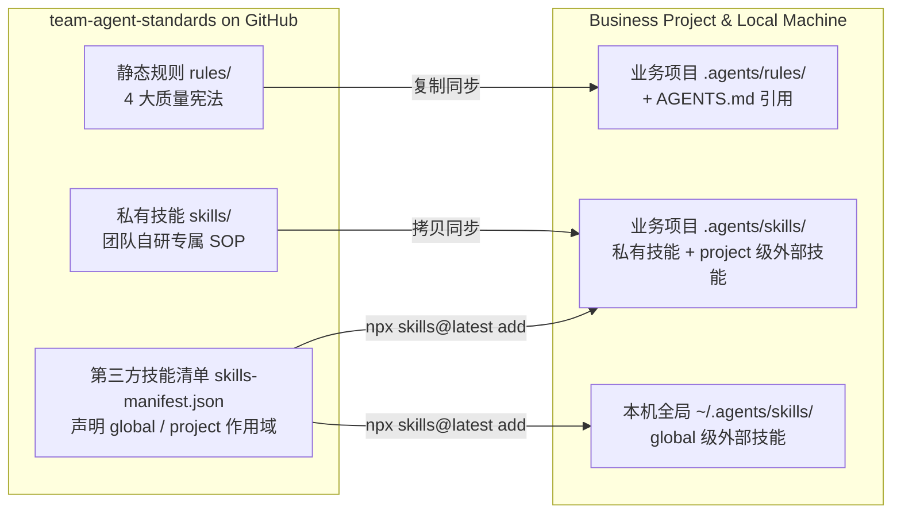

# team-agent-standards

> **团队统一的 AI Agent 研发规范与工程技能分发套件**  
> 托管于 GitHub、零外部运行时依赖的 Node.js CLI，一行命令为业务项目无损接入团队静态规则、第三方工程技能与自研私有技能。

[]()
[]()
[]()

---

## 🎯 核心架构：三类资产本地化分发

为满足现代编码 Agent 的沙箱安全边界（禁止跨父目录寻址），本套件采用**项目自包含 + 清单声明式安装**架构：



| 资产类型 | 本仓库位置 | 分发与更新方式 |
| :--- | :--- | :--- |
| **静态规则（Rules）** | [`rules/`](rules/) | 直接复制到目标业务项目 `.agents/rules/`，并在根目录入口文件增量注入引用 |
| **第三方技能（External Skills）** | [`skills-manifest.json`](skills-manifest.json) | 本仓库不内联源码，由初始化 CLI 按清单与作用域（`global` / `project`）差集批量调用 `npx skills@latest add` 安装 |
| **私有技能（Private Skills）** | [`skills/`](skills/) | 团队自研技能直接拷贝至目标业务项目 `.agents/skills/`，并通过 `.agents/.standards-manifest.json` 保护业务本地技能不被覆盖 |

---

## ⚡ 30 秒极速上手

前置要求：**Node.js >= 18**（支持 Windows PowerShell / Git Bash、macOS、Linux）。

在任意业务项目根目录运行一行命令即可完成初始化或增量更新：

```bash
npx github:<owner>/team-agent-standards
```

### 常用参数

| 参数 | 说明 |
| :--- | :--- |
| `--dry-run` | 仅预览变更，不写入文件、不执行安装命令 |
| `--update-skills` | 强制刷新安装清单中的全部第三方技能（默认跳过本地已安装项） |
| `--skip-external` | 跳过第三方技能安装，纯离线仅同步规则与私有技能 |
| `--entry <file>` | 手动指定根目录入口文件（默认按 `AGENTS.md` > `agent.md` > `GEMINI.md` > `CLAUDE.md` 命中） |
| `--agent <name>` | 透传目标 Agent 标识给第三方技能安装器（`-a <name>`） |
| `--target <dir>` | 指定目标业务项目目录（默认当前工作目录） |


初始化完成后，将生成的项目级规范资产提交至业务仓库即可全组共享：

```bash
git add .agents/ AGENTS.md
git commit -m "chore: enable team-agent-standards"
```

---

## 📏 静态规则库（The 4 Pillars）

静态规则作为单一真理来源（SSOT）维护于 `rules/` 目录，且在 [`rules/agent.md`](rules/agent.md) 中明确了**静态规则高于一切外部技能指令的最高优先级**：

1. **[`rules/agent.md`](rules/agent.md)**：Agent 行为准则、最小爆炸半径、反幻觉自测、科学排错、环境可移植性与规则优先级仲裁；
2. **[`rules/common.md`](rules/common.md)**：深度模块设计、防御性编程、类型安全、最高安全红线与依赖引入纪律；
3. **[`rules/testing.md`](rules/testing.md)**：TDD 红-绿-重构、测试隔离、合理 Mock 边界与精确断言；
4. **[`rules/git.md`](rules/git.md)**：Conventional Commits、原子性提交、PR 三要素与 Git 变动性操作强制确认红线。

---

## 🧰 规范仓库维护命令

本仓库自身零外部运行时依赖，使用 Node.js 原生能力提供完整质量门禁：

```bash
# 运行严格健康自检（校验规则、私有技能 Frontmatter、Manifest Schema、绝对路径与死链）
npm run check

# 运行零依赖单元测试（node --test）
npm test

# 基于 templates/skill-template/ 创建新的团队自研私有技能
npm run new-skill -- <your-skill-name>
```

---

## 📚 详细文档导航

- 📖 **[新人上手指南 (docs/onboarding.md)](docs/onboarding.md)**：一行命令接入、老项目升级、常用指令与 FAQ；
- 🚀 **[团队 Agent 敏捷研发 SOP 实战手册 (docs/workflow-guide.md)](docs/workflow-guide.md)**：从需求访谈到代码审查的全流程实战范例；
- 📐 **[静态规范与规则参考手册 (docs/rules-reference.md)](docs/rules-reference.md)**：4 大规则深度解读与正反代码对照；
- 🤝 **[规范与私有技能贡献指南 (docs/contributing.md)](docs/contributing.md)**：如何修改规则、新增第三方清单项、开发私有技能与提交流程；
- 🏛️ **[架构决策记录 (docs/adr/)](docs/adr/)** 与 **[领域词汇表 (GLOSSARY.md)](GLOSSARY.md)**。
