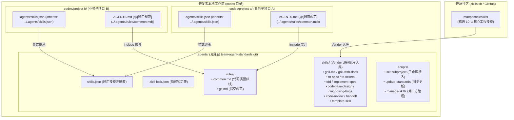

# team-agent-standards

> **团队统一的 AI Agent 辅助编程工程范式套件**  
> 为团队提供开箱即用、统一纪律的高级软件工程 SOP 技能、编码质量红线与一键接入脚手架。

[]()
[]()
[]()

---

## 🎯 项目愿景

在传统 AI 编程中，工程师往往面临 **“AI 盲目堆写代码、缺乏架构推演、风格五花八门、频繁引入隐式 Bug”** 的问题。

`team-agent-standards` 将现代敏捷软件工程全流程固化为标准化 Agent 资产：
- **静态宪法（Rules）**：常驻运行的代码质量红线、防御性编程与 Conventional Commits 提交规范；
- **动态流程（Skills）**：经受工业界实战检验的 Matt Pocock 10 大核心工程技能（SOP）；
- **极简继承（Inheritance）**：子仓库声明式继承，一人配置，全组免装即用。

---

## 🏗️ 架构图解与继承机制



---

## ⚡ 30 秒极速上手

### 步骤 1：首次安装（每台电脑仅需执行一次）
进入你的项目父级目录（如 `~/codes` 或 `D:\codes`）：

```bash
cd codes
git clone <团队远程Git仓库地址>/team-agent-standards.git .agents
```

> [!NOTE]
> 仓库在本地克隆的目录名必须为 `.agents`。所有技能源码均已内联（Vendor 模式），**无需执行 npm install，无需安装额外依赖，离线可用**。

### 步骤 2：为你的业务子项目开启规范
进入具体的业务项目目录：

- **Windows 用户 (PowerShell)**：
  ```powershell
  ..\.agents\scripts\init-subproject.ps1
  ```
- **macOS / Linux 用户 (Bash)**：
  ```bash
  ../.agents/scripts/init-subproject.sh
  ```

该命令会自动在子项目中生成：
1. `.agents/skills.json`：声明继承父级通用技能；
2. `AGENTS.md`：引入通用代码规范与 Git 提交规范。

### 步骤 3：提交配置至业务仓库
```bash
git add .agents/skills.json AGENTS.md
git commit -m "chore: enable team-agent-standards"
git push
```
**完成！** 团队其他成员拉取该分支后，因本地也存在 `.agents`，将**自动生效，零额外配置**！

---

## 🛠️ 核心技能矩阵 (Skills Cheat Sheet)

在聊天窗口随时敲入以下指令唤醒对应 SOP：

| 阶段 | 快捷指令 | 核心职责 | 典型调用场景 |
| :--- | :--- | :--- | :--- |
| **需求对齐** | `/grill-me` | 穷追不舍的需求深度访谈 | 开启新特性开发前，让 Agent 深度挖掘边界条件与逻辑漏洞 |
| **架构决策** | `/grill-with-docs` | 对齐方案并同步沉淀 ADR | 复杂重构与方案选型，自动沉淀架构决策文档（ADR） |
| **规格说明** | `/to-spec` | 对话提炼为结构化规格说明书 | 讨论结束后，将技术方案固化为正式 Spec 文档 |
| **任务拆解** | `/to-tickets` | Spec 拆解为声明依赖的原子工单 | 复杂大任务切片，防止单次提示词过大导致 AI 幻觉与遗忘 |
| **测试驱动** | `/tdd` | 严格执行测试驱动开发（红-绿-重构） | 编写新功能或修复复杂 Bug，强迫先写失败测试用例 |
| **精准实现** | `/implement-spec` | 严格按 Spec/Tickets 编写实现代码 | 执行已有工单与规范，不做过度设计 |
| **科学排错** | `/diagnosing-bugs` | 假设-验证闭环排错流程 | 遇到棘手 Bug 或性能问题，杜绝盲目改动 |
| **深度设计** | `/codebase-design` | 基于《软件设计哲学》指导深度模块设计 | 设计公共 SDK、接口抽象或决定模块切缝位置时使用 |
| **双轴审查** | `/code-review` | Standards（规范轴）+ Spec（需求轴）并行审查 | 提 PR 前运行，自动比对团队 Rules 与需求两根轴 |
| **会话交接** | `/handoff` | 将当前长会话压缩为结构化交接文档 | 会话 Token 接近上限或需要换 Agent/换人接手时调用 |

---

## 📏 通用静态规则库 (Rules)

- **`rules/common.md`（通用代码质量与安全红线）**：
  - **严禁吞异常**：杜绝空的 `catch (e) {}`，强制结构化日志上报；
  - **杜绝魔法值**：常量集中定义，变量命名强制自解释；
  - **单函数控制**：函数原则上不超过 50 行，圈复杂度严格受限；
  - **安全最高红线**：严禁硬编码任何 API Key、Token 或数据库明文凭证。
- **`rules/git.md`（Git 协同与提交规范）**：
  - 强制遵循 **Conventional Commits**（`feat:`, `fix:`, `refactor:`, `test:`, `docs:`, `chore:`）；
  - 原子性提交原则；
  - 统一分支命名标准（`feature/*`, `bugfix/*`）。

---

## 🧰 运维脚本套件 (`scripts/`)

| 脚本文件 | 适用系统 | 核心功能 |
| :--- | :--- | :--- |
| `init-subproject.ps1 / .sh` | Windows / Unix | 业务子项目一键接入脚手架 |
| `install.ps1 / .sh` | Windows / Unix | 团队新成员一键克隆安装自检工具 |
| `update-standards.ps1 / .sh` | Windows / Unix | 一键同步拉取团队最新规范与技能 |
| `manage-skills.ps1 / .sh` | Windows / Unix | 架构师维护第三方开源技能工具 (List / Add / Update / Audit) |
| `check-health.ps1 / .sh` | Windows / Unix | 规范完整性与 Frontmatter 格式自检脚本 |

---

## 📚 详细文档导航

- 📖 [新人 5 分钟上手指南](docs/onboarding.md)
- 🚀 [团队 Agent 敏捷研发 SOP 实战手册](docs/workflow-guide.md)
- 📐 [静态规范与规则参考手册](docs/rules-reference.md)
- 🤝 [自研 Skill 贡献与发版指南](docs/contributing.md)

---

## 🔄 团队日常更新与同步

```bash
# 方式 A：进入 .agents 目录直接拉取
cd codes/.agents
git pull

# 方式 B：执行更新自检脚本
..\.agents\scripts\update-standards.ps1
```
更新后，本地所有业务子项目立即同步获得团队最新研发能力！
