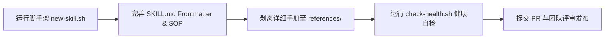
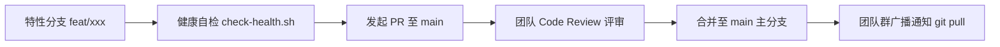

# 团队规范贡献与发版指南 (Contributing Guide)

**`team-agent-standards`** 是全团队工程师共同沉淀与维护的核心数字工程资产。  
当你在业务实战中探索出了优质的 Agent 交互 SOP、自动化辅助脚本、或发现某条通用规则存在边界疏漏时，非常欢迎将你的思考沉淀并贡献回本项目，共同提升全团队的研发效能与工程质量！

---

## 🧭 规范贡献的三大核心原则

在提议新增技能或修改规则前，请评估是否符合以下原则：
1. **普适性 (Broad Applicability)**：贡献的技能或规则应对团队绝大多数业务项目具有复用价值，而非仅适用于某个特定业务项目的孤立业务逻辑（特定项目的专属规则应写在业务项目的 `AGENTS.md` 中）；
2. **确定性 (Determinism)**：SOP 流程或规范描述必须清晰、无歧义，Agent 在理解后能做出非黑即白的确定性动作，避免模棱两可的模糊描述；
3. **Token 经济性 (Token Efficiency)**：遵循“渐进式披露”原则。长篇参考文档应剥离至子目录，核心 `SKILL.md` 或 `Rules` 保持精炼，避免过度消耗 Agent 的上下文窗口。

---

## 一、 如何贡献自研新技能 (Custom Skills)

本项目提供了完备的脚手架工具，严格遵循业界标准的 Skill 目录规范。



### 1. 使用脚手架一键生成骨架
切勿手动创建或零散复制文件，在 `team-agent-standards` 根目录下执行：

```bash
bash ./scripts/new-skill.sh <your-skill-name>
# 示例：创建 API Mock 自动化生成技能
bash ./scripts/new-skill.sh api-mock-generator
```

> [!NOTE]
> 技能名称必须遵循小写连字符命名规范（如 `my-awesome-skill`）。脚本会自动从 `templates/skill-template` 复制标准目录结构并替换占位符。

### 2. 标准技能目录结构与职责分工
```text
skills/<your-skill-name>/
├── SKILL.md                 # 【必需】主执行说明与 Frontmatter 触发器
├── references/              # 【可选】长篇技术协议、Schema 契约（渐进式加载）
│   └── guide.md
└── scripts/                 # 【可选】配套的自动化执行脚本
```

### 3. Frontmatter 编写要点（最关键环节）
`SKILL.md` 顶部的 YAML Frontmatter 是 Agent 运行时**决定是否唤醒该技能的唯一判断依据**：

```markdown
---
name: api-mock-generator
description: >-
  用于根据 OpenAPI/Swagger 契约自动化生成微服务 Mock 接口与假数据。当用户提出需要模拟接口响应、创建测试桩或生成契约 Mock 服务时激活。
---
```

> [!IMPORTANT]
> - **人称要求**：必须使用**第三人称客观叙述**（如“用于自动化生成...，当用户提出...时激活”），严禁使用第一人称（“我可以帮你...”）；
> - **激活条件明确**：必须写清楚“该技能解决什么问题”以及“在何种用户意图/场景下激活”。

### 4. 编写 SOP 标准执行流程（黄金三段式）
`SKILL.md` 正文建议统一遵循如下三段式结构：
- **步骤 1：前置准备与检查**：检查必要的数据模型、配置文件或网络连通性；
- **步骤 2：核心流程执行**：按步骤清晰指导 Agent 生成代码或执行操作；复杂长篇规范引用 `[references/guide.md](./references/guide.md)` 引导 Agent 按需渐进读取；
- **步骤 3：结果验证与闭环**：指导 Agent 真实执行校验命令，验证产物合法性后向开发者汇报。

### 5. 运行本地健康检查
提交前，必须运行本地健康自检工具：
```bash
bash ./scripts/check-health.sh
```
确保 Frontmatter 校验 100% 通过（`PASS`），无缺失文件。

---

## 二、 如何提议修改通用 Rules

通用规则（`rules/agent.md`, `rules/common.md`, `rules/testing.md`, `rules/git.md`）是全团队所有业务项目共享的工程红线，任何改动都会直接影响所有工程师的 Agent 行为。因此，修改规则需遵循更严格的评审机制：

1. **发起讨论**：在团队群或 GitHub Issue 中提出修改动机（Why），并附带业务场景中的真实失败或冲突案例；
2. **保持向下兼容**：优先补充清晰的判例（Good vs Bad），避免突兀地删除既有红线；
3. **核心评审通过**：规则修改 PR 必须经过至少 2 位团队核心工程师的 Code Review 签署同意（Approve）后方可合并。

---

## 三、 引入第三方开源 Skill 的标准

如果社区（如 `skills.sh` 或 GitHub 开源仓库）有成熟的优秀 Skill 适合引入团队规范库：

### 1. 严格的安全审查防线
引入前必须人工仔细审查开源 Skill 的 `SKILL.md` 提示词与脚本：
- **严防提示词注入 (Prompt Injection)**：排查是否含有试图越权读取本地敏感凭证（如 `~/.ssh`, `~/.aws`）的诱导性提示词；
- **排查高危系统指令**：排查附带脚本中是否有未经确认的删除、格式化或非安全网络外发操作。

### 2. 使用管理工具规范引入与锁定版本
使用运维脚本引入第三方技能，并自动记录入库版本：
```bash
# 搜索社区技能
bash ./scripts/manage-skills.sh find <关键词>

# 安装并锁定技能版本至 .skill-lock.json
bash ./scripts/manage-skills.sh add <包名或GitHub仓库地址>

# 审查工作区变动
bash ./scripts/manage-skills.sh audit
```

### 3. Vendor 源码随 Git 入库
所有引入的技能必须完整以内联源码形式提交入库，确保团队在离线、内网环境下均能平稳工作。

---

## 四、 PR 提交与团队同步发布流程



1. **从 `main` 分支切出特性分支**：
   ```bash
   git checkout -b feat/add-api-mock-skill
   ```
2. **执行自检**：
   ```bash
   bash ./scripts/check-health.sh
   ```
3. **提交规范 Commit**（必须遵循 Conventional Commits）：
   ```bash
   git add .
   git commit -m "feat(skills): add api-mock-generator custom skill"
   ```
4. **发起 Pull Request**：
   PR 描述中必须写明：
   - **背景与动机 (Why)**：该 Skill 或规则修改解决了什么具体工程痛点；
   - **核心改动 (What)**：改动的文件与新增的指令说明；
   - **验证凭证 (Verification)**：本地 `check-health.sh` 执行通过的终端日志。
5. **发布与团队同步**：
   PR 合并入主分支后，在团队群广播更新摘要，提醒大家在各自本地执行：
   ```bash
   cd codes/.agents && git pull
   ```
